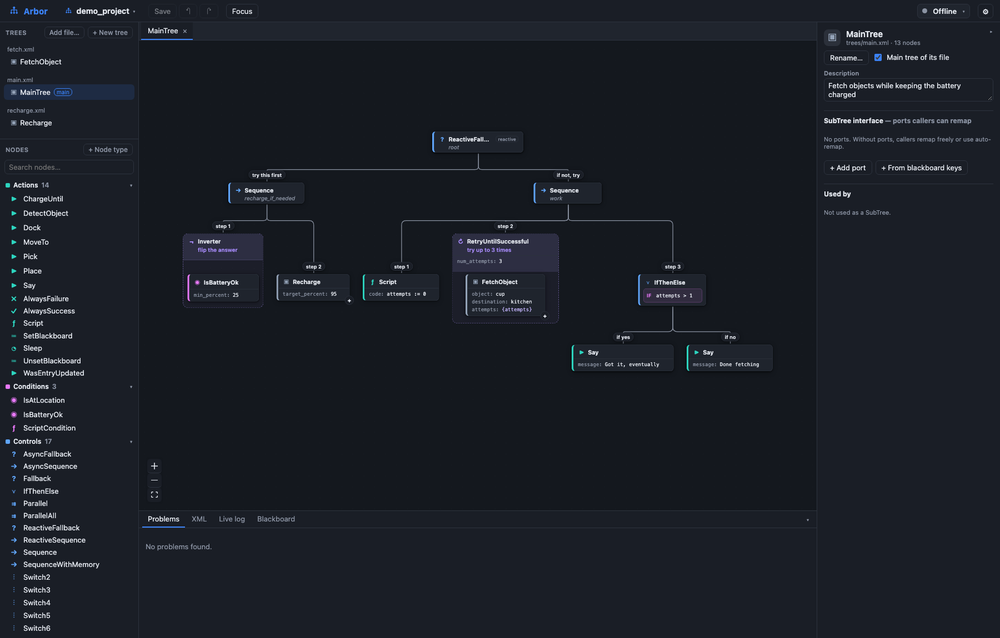

# 

A local editor and live viewer for [BehaviorTree.CPP](https://www.behaviortree.dev/) v4 trees. It runs as a small Node.js backend that serves a browser UI and reads and writes a **project directory** of plain BT.CPP XML. It can also attach to a running robot and show the tree executing, node by node.



## Quick start

The desktop app for Linux, macOS and Windows (x64 and arm64) is attached to each [GitHub release](https://github.com/coalman321/Arbor/releases): a `.dmg` for macOS, an installer `.exe` for Windows, and an `.AppImage` for Linux. 

To open on Macos go to **System Settings → Privacy & Security** and click **Open Anyway** next to the message about Arbor. Windows SmartScreen may also warn; click **More info → Run anyway**.

To run from source, you need Node 22 or newer.

```bash
git clone https://github.com/coalman321/Arbor.git
cd Arbor
npm ci
npm run build   # bundles the UI into dist/
npm start       # http://127.0.0.1:8080
```

Try the live view without a robot by running the mock robot, which simulates the demo project:

```bash
npm run mock-robot -- --project examples/demo_project
```

Then press **Connect** in the top-right corner, with the URL `ws://localhost:1670`.

Other commands:

| | |
|---|---|
| `npm run dev` | Backend plus Vite with hot reload, on the demo project |
| `npm start` | Start with no project: the browser shows recent projects, **New project…** and **Open project…** |
| `npm start -- --root DIR` | Only let the UI browse, open and create projects under `DIR` (the default when `--host` isn't loopback is the current directory) |
| `npm start -- init DIR` | Create an empty project |
| `npm test` | Unit tests (vitest) |
| `npm run typecheck` | `tsc --noEmit` |

`--host 0.0.0.0` makes the editor reachable from other machines. The API can write files in the project and has no authentication, so do that only on a trusted network.

### Building the desktop app

The desktop app is an Electron wrapper around the same backend and UI. From a checkout with dependencies installed (`npm ci`):

```bash
npm run desktop          # build the bundle and open the app straight from the checkout
npm run build:desktop    # package an installer into release/
```

`build:desktop` builds for the platform and CPU you run it on, and names the file `Arbor-<version>-<os>-<arch>.<ext>`:

| Platform | Output |
|---|---|
| macOS | `release/Arbor-<version>-mac-<arch>.dmg`, plus the unpacked `Arbor.app` in `release/mac-<arch>/` |
| Windows | `release/Arbor-<version>-win-<arch>.exe` (NSIS installer) |
| Linux | `release/Arbor-<version>-linux-<arch>.AppImage` |

The packaging settings (app ID, targets, icons from `resources/`) are in the `build` field of [package.json](package.json).

To publish a new version, follow [docs/releasing.md](docs/releasing.md).

## Projects

```
my_project/
├── bt_project.json     optional; the defaults are shown below
├── nodes.xml           node spec: which node types exist and their ports
└── trees/              one or more tree files, searched recursively
    ├── main.xml
    └── fetch.xml
```

```json
{
  "name": "my_project",
  "nodes": "nodes.xml",
  "trees": "trees",
  "live": { "url": "ws://robot.local:1670" }
}
```

### The node spec (`nodes.xml`)

The node spec is a `TreeNodesModel` in exactly the format `BT::writeTreeNodesModelXML()` writes, so it can be generated from the robot code that registers the nodes rather than written by hand:

```cpp
#include <behaviortree_cpp/bt_factory.h>
#include <behaviortree_cpp/xml_parsing.h>
#include <fstream>

BT::BehaviorTreeFactory factory;
factory.registerNodeType<MoveTo>("MoveTo");
// ...
std::ofstream("path/to/project/nodes.xml") << BT::writeTreeNodesModelXML(factory);  // builtins left out
```

The editor reads the spec directly. Builtin nodes (`Sequence`, `RetryUntilSuccessful`, `Script`, ...) are built into the editor and match BT.CPP 4.9. You can also add or edit node types from the editor ("+ Node type"), which is handy for designing a tree before the C++ exists.

### Tree files

Each file in `trees/` is a normal BT.CPP v4 file. It can hold several `<BehaviorTree>`s, plus a `<TreeNodesModel>` with `<SubTree>` entries that declare the trees' ports. Tree IDs are unique across the project, so a SubTree can reference a tree in any file. To load a project on the robot, register every file:

```cpp
for (const auto& file : std::filesystem::recursive_directory_iterator(project / "trees")) {
    if (file.path().extension() == ".xml") factory.registerBehaviorTreeFromFile(file.path());
}
BT::Tree tree = factory.createTree("MainTree");
```

The editor writes files in a canonical layout: two-space indent, attributes in their original order. **XML comments inside tree files are not preserved.** Use a tree's or node's description instead. Groot2-style node models copied into tree files are kept.

## Using the editor

- **Add nodes:** drag a node from the palette onto a node. Drop on the middle of a node to add it as the node's last child. Drop on its left or right edge (top or bottom edge in left-right layout) to add it as a sibling before or after. You can also double-click a palette entry to add it to the selected node, or press <kbd>A</kbd> to search for a node type to add.
- **Rearrange:** drag a node (with its children) onto another node, using the same drop zones. You can also use <kbd>Alt</kbd>+<kbd>↑</kbd>/<kbd>↓</kbd> to reorder siblings. Right-click a node for *Wrap in…*, *Change type…*, *Unwrap*, *Duplicate*, copy and paste, and delete.
- **Edit ports:** select a node and use the inspector on the right. Port types, defaults and descriptions come from the spec. The `{}` button switches a port between a literal value and a blackboard entry. Pre- and post-conditions (`_skipIf`, `_onSuccess`, ...) are under *Pre/post conditions*.
- **SubTrees:** drag a tree from the *Trees* list onto a node to use it as a SubTree. The SubTree's inspector shows the target tree's ports for remapping, and has an auto-remap switch. Click a SubTree's **+** to see its contents inline (read-only), or double-click it to open it. *Extract to SubTree…* moves a selected branch into a new tree. The blackboard keys the branch uses become the new tree's ports, remapped one to one, so behavior is unchanged.
- **Conditions:** `IfThenElse` and `WhileDoElse` draw their condition (the first child) inside their own box, as `IF battery_ok` or `WHILE ¬IsEstopped ∧ IsArmed`. Only the branches are drawn as children, with *then*/*else* (or *do*/*else*) on their edges. Composite conditions keep their structure: `¬` is an `Inverter`, `∧` a `Sequence`, `∨` a `Fallback`. Click any part to select and edit it, or right-click it for the node menu. In the live view each part is colored by its result. `Precondition`'s `if` script is drawn the same way. The XML is unchanged: the condition is still the first child. A new `IfThenElse`'s first added child becomes its condition (the picker says *Add condition*, then *Add then-branch*).
- **Decorators** (`RetryUntilSuccessful`, `Timeout`, `Inverter`, `Precondition`, ...) are drawn as a frame around the child they decorate and everything below it. The decorator's own content (type, ports, `Precondition`'s `if`) is the frame's header. Click the header to select the decorator, or drag it to move the decorator with its subtree. The rest of the frame lets clicks through to the nodes inside. In the live view the frame's border shows the decorator's status. **Decorator frames** in the toolbar switches back to separate boxes. A decorator without its child is always a box, so you can drop one in.
- **Organizing trees.** Each tree's ⋯ menu (or right-click) has Open, Rename, **Move to file…** (another file, or a new one) and main-tree/delete. You can also drag a tree onto another file's name in the list to move it there. SubTrees refer to trees by name, so they keep working; a file left with no trees is deleted on save. The handle between the Trees and Nodes lists resizes them (double-click to reset).
- **Projects and tree files.** Click the project name (top left) for **New tree…**, **Add a tree file…** (copies an existing BT.CPP `.xml` into `trees/`; refused if it doesn't parse or reuses a tree ID the project already has), **New project…**, **Open project…** and recent projects (kept in `~/.config/bt-editor/recent.json`). The folder browser runs on the backend, since a browser can't see local paths. Switching asks first if there are unsaved changes. All browser tabs follow a switch; a tab with unsaved edits instead shows a banner and refuses to save into the other project until you **Reopen** its own.
- **Replaying logs.** **Replay log…** plays back a recorded `.btlog`. See [Log Replay](#log-replay).
- **Inline SubTrees are locked.** Expanding a SubTree node (**+**) shows its tree inside a hatched frame headed *🔒 FetchObject · from fetch.xml* with an **Open to edit** button: those steps live in another file (and may be used elsewhere), so they're edited in their own tab. Dragging a palette node or an existing node over the frame shows a not-allowed cursor, and dropping there does nothing.
- **Dragging moves the whole branch.** Grab a node (or a decorator frame by its header) and its children come along while you drag; drop it onto another node to move it there, or anywhere else to put it back.
- **Explain** (toolbar, on by default) labels every connection in plain words, so someone new to behavior trees can read a tree out loud: *step 1, step 2* under a Sequence, *try this first, if not, try* under a Fallback, *if yes / if no* for IfThenElse, *at the same time* for Parallel, *if mode is dock / otherwise* for a Switch. Decorators say what they do with their own values, e.g. *try up to 3 times*, *stop after 1.5 s*, *flip the answer*: on their edge, or in the header when drawn as a frame. Hover a label for a full sentence. Turned off, only *then / else* labels remain.
- **Tree properties** (deselect with <kbd>Esc</kbd>): rename (updates every SubTree that references the tree), description, main-tree flag, and the tree's port interface.
- **Problems** (bottom panel) lists what BT.CPP would reject: unknown node types, wrong child counts, missing or recursive SubTrees. It also lists softer issues, such as unset input ports or output ports not bound to the blackboard. Click a problem to jump to its node.
- **XML** (bottom panel) shows the file exactly as it will be saved.
- **Saving:** <kbd>Ctrl</kbd>+<kbd>S</kbd> saves every changed file. If a file changes on disk and you have no unsaved edits to it, the editor reloads it. If you do have edits, it asks whether to reload or keep yours. A save never silently overwrites someone else's change.

| Shortcut | |
|---|---|
| <kbd>Ctrl</kbd>+<kbd>S</kbd> | Save all |
| <kbd>Ctrl</kbd>+<kbd>Z</kbd> / <kbd>Ctrl</kbd>+<kbd>Shift</kbd>+<kbd>Z</kbd> | Undo / redo (per tree) |
| <kbd>Ctrl</kbd>+<kbd>W</kbd> | Close the current tab (in the desktop app, <kbd>Ctrl</kbd>+<kbd>Shift</kbd>+<kbd>W</kbd> closes the window) |
| <kbd>A</kbd> | Add a child (or sibling) to the selection |
| <kbd>Del</kbd> | Delete the selected node and its children |
| <kbd>Ctrl</kbd>+<kbd>C</kbd> / <kbd>X</kbd> / <kbd>V</kbd> / <kbd>D</kbd> | Copy / cut / paste / duplicate |
| <kbd>Alt</kbd>+<kbd>↑</kbd> / <kbd>↓</kbd> | Move among siblings |
| <kbd>F</kbd> | Fit the tree to the view |
| <kbd>Esc</kbd> | Deselect |

## Live view

Connect to a robot that runs a [btlive](docs/live_protocol.md) server. The connection goes through the editor's backend, so the robot only needs to be reachable from the machine running `npm start`. The editor opens the tree the robot is running and colors it as it executes:

- **Orange:** running.
- **Green / red:** succeeded / failed.
- **Faded green / red:** the node's last result, after BT.CPP reset it to idle.

Statuses show inside SubTrees too: expand them inline, or open the subtree's own tab.

The bottom panel's **Live log** lists every transition (click one to jump to its node), and **Blackboard** shows each tree instance's entries. **Pause** freezes the display without disconnecting.

The editor pairs the robot's nodes with the project's by tree structure. If the robot runs a different version of a tree than the one open (say, unsaved edits, or an older deploy), the toolbar shows a mismatch badge, and the log lists what differs. The rest of the tree still shows live.

To add the server to a C++ application that uses BehaviorTree.CPP, use the reference implementation in [cpp/](cpp/README.md): construct a `btlive::Server` and `attach()` your tree. It includes a demo that runs `examples/demo_project` on real BehaviorTree.CPP.

The protocol is specified in [docs/live_protocol.md](docs/live_protocol.md).

## Log Replay

Arbor can play back a run recorded on the robot, showing it the same way as the live view: node colors, SubTree statuses, and the **Live log** tab. Nothing on the robot needs to be reachable.

### Recording a log

Arbor reads the `.btlog` files that BehaviorTree.CPP's `BT::FileLogger2` writes. Groot2 uses the same format. Attach a logger to the tree. It records every status change until it is destroyed:

```cpp
#include <behaviortree_cpp/loggers/bt_file_logger_v2.h>

BT::Tree tree = factory.createTree("MainTree");
BT::FileLogger2 logger(tree, "run.btlog");
tree.tickWhileRunning();
```

### Opening a log

1. Open the project the log was recorded from. Arbor matches the logged tree to the project's trees by structure, as it does with a live robot.
2. Open the log in one of these ways:
   - Click **Replay log…** next to **Connect**.
   - Choose **Replay a log file (.btlog)…** in the project menu (click the project name, top left).
   - Drag a `.btlog` file onto the window.

Opening a log disconnects you from any live robot. To go back to editing, close the log with **×** on the replay bar.

### Playback controls

A replay bar appears under the canvas:

| Control | Shortcut | |
|---|---|---|
| Play / pause | <kbd>Space</kbd> | |
| Step to the previous / next change | <kbd>←</kbd> / <kbd>→</kbd> | Jumps to the next status transition, however far away it is |
| Skip back / forward 1 s | <kbd>Shift</kbd>+<kbd>←</kbd> / <kbd>→</kbd> | |
| Go to the start / end | <kbd>Home</kbd> / <kbd>End</kbd> | |
| Timeline | | Drag to seek. Green and red marks show where the whole tree succeeded or failed. |
| Speed | | 0.1×, 0.25×, 0.5×, 1×, 2×, 4× or 10× |

Hover the time display to see the robot's wall-clock time at the current position. Click an entry in the **Live log** tab to jump to its node.

### Limitations

- **Tree mismatches:** if the project's trees have changed since the log was recorded, the replay bar shows an *N nodes not in project* badge. Hover the badge to see what differs. The parts of the tree that still match play back normally.
- **No blackboard:** `.btlog` files record only node statuses, so the **Blackboard** tab is empty during replay.
- **Rejected files:** files that aren't a `FileLogger2` log are rejected with an error. A log that ends partway through a record, for example because the robot crashed, still plays up to that point.

## Embedding the viewer: Arborist

Loading, laying out and drawing trees, live status overlays and diffs live in a separate library,
[Arborist](packages/arborist) (`@coalman321/arborist`), so other tools can show trees the way Arbor
does. Arbor itself is built on it. See [its README](packages/arborist/README.md).

## How it's built

```
packages/arborist/  the Arborist library: model, XML parsing, layout, diffs, statuses, React views
src/
├── shared/   project/API types, validation, XML writer, .btlog reader
├── server/   backend: CLI, project loading/saving (project.ts), file watching, robot relay
├── desktop/  Electron app: runs the backend and shows the UI in a window
├── web/      React + React Flow editor; store.ts holds all state, actions.ts the edit commands
└── mock/     mock robot that speaks btlive
cpp/          btlive server for BehaviorTree.CPP applications, and a demo robot
```

The npm workspace links `packages/arborist` into the app, which uses its TypeScript sources directly
(the package's `source` export condition), so changes to the library need no build step.

The backend owns the files: it parses XML into the JSON model (Arborist's `loadTrees()`) and writes it
back with `shared/xml_write.ts`. The frontend only ever edits JSON. The API, all on the one port:

| | |
|---|---|
| `GET /api/project` | Manifest, spec models, files and parsed trees, load diagnostics |
| `PUT /api/files` | Write one tree file; refused with 409 if it changed on disk since `baseVersion` |
| `DELETE /api/files?path=` | Delete a tree file |
| `PUT /api/spec` | Rewrite the node spec |
| `WS /api/events` | `files_changed` notifications from the project directory |
| `WS /api/live?url=ws://…` | Relay to a robot |

## License

MIT, see [LICENSE](LICENSE).
